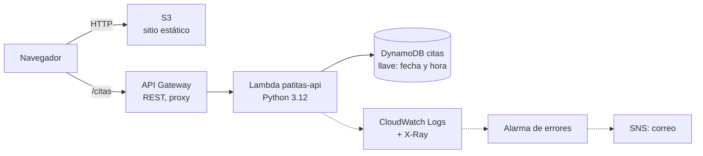

# Veterinaria Patitas: agenda web de citas

Agenda web para la Veterinaria "Patitas", una clínica de Bogotá que hoy agenda por teléfono. El dueño de la mascota puede **agendar, consultar y cancelar** citas sin crear una cuenta. El sistema impide que dos citas ocupen la misma franja, protege los datos personales según la Ley 1581 de 2012 y se despliega con un pipeline de GitHub Actions sobre infraestructura como código.

Proyecto del curso de arquitectura cloud de la Escuela Colombiana de Ingeniería Julio Garavito.

## Integrantes

| Nombre | GitHub |
|---|---|
| Karol Estupiñán | [@Karol2905](https://github.com/Karol2905) |
| Julián Castiblanco | [@JulCR34l](https://github.com/JulCR34l) |

## Arquitectura

Arquitectura serverless en AWS. Para el MVP se despliega sobre [Floci](https://github.com/floci-io/floci), un emulador de AWS de código abierto que no requiere cuenta.



| Componente | Detalle |
|---|---|
| Sitio | `frontend/` (HTML, CSS y JavaScript sin frameworks) en un bucket S3. `config.js` lo genera Terraform con la URL de la API. |
| API | API Gateway REST con integración proxy hacia una sola Lambda. |
| Lambda | `backend/handler.py` enruta; `validacion.py` valida y enmascara; `repositorio.py` accede a DynamoDB. 128 MB, concurrencia máxima de 10, arm64 en AWS y x86_64 en Floci. |
| Datos | DynamoDB on-demand con llave `pk = fecha#hora`, cifrado en reposo y recuperación a un punto en el tiempo (PITR). |
| Operación | Logs en CloudWatch (14 días), trazas con X-Ray y una alarma si la Lambda tiene errores en 5 minutos, que avisa por SNS. |

**Decisiones clave:**
- **Sin doble reserva.** `guardar` escribe con la condición `attribute_not_exists(pk)`. Si dos personas piden la misma franja a la vez, solo una lo logra; la otra recibe `409`.
- **Cancelar libera la franja sin perder el historial.** Una transacción copia la cita a `pk = CANCELADA#<id>` con `estado = CANCELADA` y borra el registro de la franja.
- **Datos personales.** Se exige aceptar el tratamiento de datos (`consentimiento_en`), el listado devuelve el correo y el teléfono enmascarados (`j***@gmail.com`, `******4567`) y los logs solo registran el id de la cita.

## Estructura

```
backend/            Lambda: handler.py, repositorio.py, validacion.py
frontend/           Sitio estático: index.html, app.js, styles.css, img/
infra/              Terraform: tabla, Lambda, API, sitio y monitoreo; dev.tfvars y prod.tfvars
tests/              Pruebas con pytest y moto (conftest.py, eventos.py, unit/)
scripts/            servidor_local.py y smoke_test.py
.github/workflows/  ci.yml y deploy.yml
docker-compose.yml  Floci en el puerto 4566
```

## Cómo correrlo en local

Requisitos: Python 3.12. Para Floci, además: Docker y Terraform 1.6 o superior.

### 1. Pruebas

```bash
python -m venv .venv
source .venv/bin/activate        # Windows (Git Bash): source .venv/Scripts/activate
pip install -r requirements-dev.txt

ruff check .
pytest
```

Las pruebas usan [moto](https://github.com/getmoto/moto) para simular DynamoDB, así que no necesitan AWS ni Docker.

### 2. Servidor local (sin Docker)

```bash
python scripts/servidor_local.py
```

Abre http://localhost:8000. El script sirve el frontend y pasa las peticiones de `/api` a `lambda_handler`, con DynamoDB simulado en memoria por moto. Arranca con cuatro citas de ejemplo; con `--vacio` arranca sin citas. Los datos se borran al cerrarlo con `Ctrl+C`.

### 3. Floci + Terraform (el mismo despliegue del pipeline)

```bash
docker compose up -d
curl http://localhost:4566/_localstack/health

cd infra
terraform init
terraform apply -var-file=dev.tfvars

terraform output url_sitio
terraform output url_api
```

Abre la URL de `url_sitio` en el navegador. Para correr el smoke test contra ese despliegue, desde la raíz del repo:

```bash
python scripts/smoke_test.py "$(terraform -chdir=infra output -raw url_api)" "$(terraform -chdir=infra output -raw url_sitio)"
```

Para borrar todo: `terraform -chdir=infra destroy -var-file=dev.tfvars` y `docker compose down`.

Para desplegar en una cuenta real de AWS basta con dejar `endpoint` vacío en el archivo `.tfvars`: el proveedor toma las credenciales del entorno.

## Endpoints

Base: la salida `url_api` de Terraform (o `http://localhost:8000/api` con el servidor local). Todas las respuestas son JSON e incluyen los encabezados CORS.

| Método y ruta | Descripción | Respuestas |
|---|---|---|
| `POST /citas` | Agenda una cita | `201` cita creada · `400` `{"errores": [...]}` · `409` franja ocupada |
| `GET /citas?fecha=AAAA-MM-DD` | Lista las citas, ordenadas por fecha y hora. `fecha` es opcional | `200` lista con correo y teléfono enmascarados |
| `DELETE /citas/{id}` | Cancela una cita y libera su franja | `200` `{"id", "estado": "CANCELADA"}` · `404` no existe |
| `OPTIONS` (cualquier ruta) | Preflight de CORS | `200` |

Ejemplo de `POST /citas`:

```json
{
  "fecha": "2026-12-01",
  "hora": "09:30",
  "mascota": "Pachito",
  "especie": "Gato",
  "dueno": "Juan Pérez",
  "correo": "juan@gmail.com",
  "telefono": "3001234567",
  "motivo": "Vacunación",
  "acepta_tratamiento_datos": true
}
```

Reglas: `fecha`, `hora`, `mascota`, `especie`, `dueno`, `correo` y `telefono` son obligatorios; `acepta_tratamiento_datos` debe ser `true`; la fecha no puede estar en el pasado ni ser domingo; la hora va de `08:00` a `17:30`, en punto o y media.

## Pipeline

### Ramas

| Rama | Uso |
|---|---|
| `main` | Versión estable. Se despliega en el ambiente `prod`. |
| `develop` | Integración. Se despliega en el ambiente `dev`. |
| `feat/*`, `fix/*` | Una tarea. Se fusiona en `develop` por pull request. |

Los rulesets de GitHub impiden el push directo y el force push a `main` y `develop`. Todo entra por pull request con una aprobación, conversaciones resueltas y los checks de CI en verde. Los tags `v*` no se pueden mover ni borrar.

### CI (`ci.yml`), en cada pull request a `develop` o `main`

| Job | Qué hace |
|---|---|
| **Lint y pruebas** | `ruff check .` y `pytest` |
| **Terraform** | `terraform fmt -check` y `terraform validate` |
| **Checkov** | Análisis de seguridad de la infraestructura (`.checkov.yaml`) |

Si alguno falla, el pull request no se puede fusionar.

### Despliegue (`deploy.yml`), en cada push a `develop` o `main`

1. **Lint y pruebas** otra vez sobre el commit que se va a desplegar.
2. **Desplegar en Floci**: levanta Floci, `terraform apply` con `dev.tfvars` o `prod.tfvars`, y lee las URL de salida.
3. **Smoke test** (`scripts/smoke_test.py`): el sitio responde, se crea una cita, la misma franja responde `409`, la cita aparece con el correo enmascarado, se cancela y la franja se puede volver a agendar.
4. **Resumen** con la versión y las URL en la página de la ejecución.

El despliegue a `prod` usa el ambiente `prod` de GitHub, que pide la aprobación de uno de los integrantes antes de ejecutarse.

## Rollback

Cada versión estable se marca con un tag `vX.Y.Z` después de fusionar en `main`, y el ruleset lo protege contra cambios y borrado:

```bash
git checkout main && git pull
git tag v1.0.0
git push origin v1.0.0
```

Para volver a una versión anterior:

1. En GitHub, **Actions → Deploy → Run workflow**.
2. En **Use workflow from**, elige `main` (para `prod`) o `develop` (para `dev`).
3. En **version**, escribe el tag o el commit al que quieres volver, por ejemplo `v1.0.0`.
4. **Run workflow.** El pipeline vuelve a correr las pruebas, despliega esa versión con Terraform y ejecuta el smoke test.

El rollback revierte el código y la infraestructura, no los datos. Para los datos, en AWS real, la tabla tiene PITR: se restaura a una tabla nueva en el segundo anterior al problema y se apunta `TABLE_NAME` a ella con Terraform.
